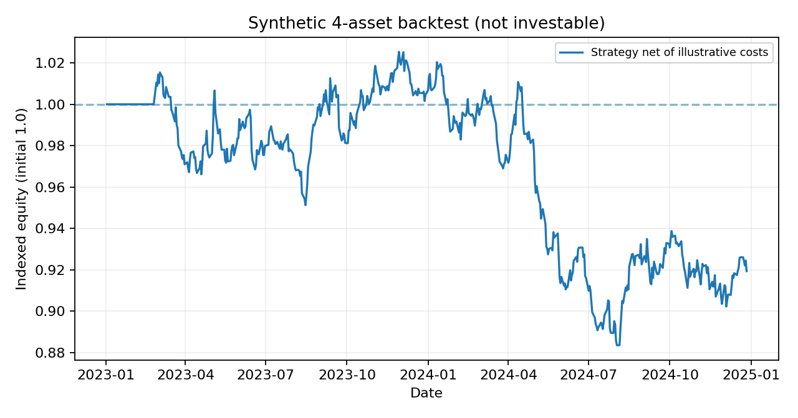

# Cross-Asset Systematic Trading & P&L Dashboard (Python)

**Four-asset systematic research**: momentum and reversal signals; strict one-day lag; per-asset / aggregate gross exposure limits; diagonal realized-vol proxy target; turnover-based costs; performance, drawdown and gross asset P&L contribution analysis.



*Model-generated synthetic example, not live-market results.*

## Run

```bash
python -m pip install -e '.[dev]'
python -m pytest -q
python examples/run_demo.py
streamlit run app.py
```

## Data choices

1. **Synthetic**: fixed-seed correlated random return series, ideal for testing the full pipeline.
2. **Your aligned historical CSV**, using `date,equity,rates,fx,commodity` with **decimal daily simple returns**, ideally *investable, total-return* instruments with corporate actions and realistic funding accounted for.
3. **Optional FRED historical proxies**, pulled individually via CSV: `SP500`, `DGS10`, `DEXUSEU`, `DCOILWTICO`. These are **not four tradeable total-return assets**. In particular, `rates = -7 × Δ(10y US Treasury yield in decimal)` is a **duration-only** approximation (no carry/coupon/convexity) and WTI / FX are spot series. FRED's historical S&P 500 series has limited lookback. An authentic portfolio backtest needs compatible tradable futures/ETF total-return prices, contract rolls and funding.

## Backtesting controls and limits

- Signals from a *trailing* log-return window; exposures shifted by 1 full observation before multiplying by that day's returns.
- Approximate diagonal volatility model ignores correlations and never leverages up to target; during warmup allocations stay at 0.
- Absolute position weights, gross exposure and proportional turnover costs enforced; cumulative P&L is an illustrative **dimensionless return index**, not monetary desk P&L.
- No borrow fees, financing, dividends, futures contract rolls, market impact, taxes, risk-free return, regime selection bias or release-calendar modeling. No Sharpe significance or investable claims.

**CV description:** *Backtested equity, rates, FX and commodity signals with trading costs, position risk limits and P&L attribution.*
